# Architecture

_Updated 2026-11-20 (Unity road tunnels and avalanche galleries, overpass carve rule, ways meeting at one height; Unity solids: footprint push-out, placement check, swept spins; gravel max 120 km/h; Unity game renamed Grand Tour Norway, start screen / LOG bar / MENU; Unity tile seams and streaming frame budget; Unity route map place search; Unity bridges over water: Roads/Bridges + BridgeMesh, deck-aware TileWorld ground; Unity car chooser: eight cars from Art/Cars incl. two buggies, CarSpec per car; 2026-11-19: Unity road signs; JS road splines, junctions and bridges; 2026-11-16 evening: Unity rewrite layers added)._

Retro Norway Rally is a static, browser-only Three.js game, kept in
`legacy-js/` while the Unity/WebAssembly rewrite grows in `unity/`
(plan: `tasks/plan_20261116_unity.md`, layout: `unity/CONVENTIONS.md`). There is no
backend: terrain, map features and road signs are fetched straight from
public Norwegian geodata services and OpenStreetMap, then turned into
low-poly geometry on the fly.

## Modules

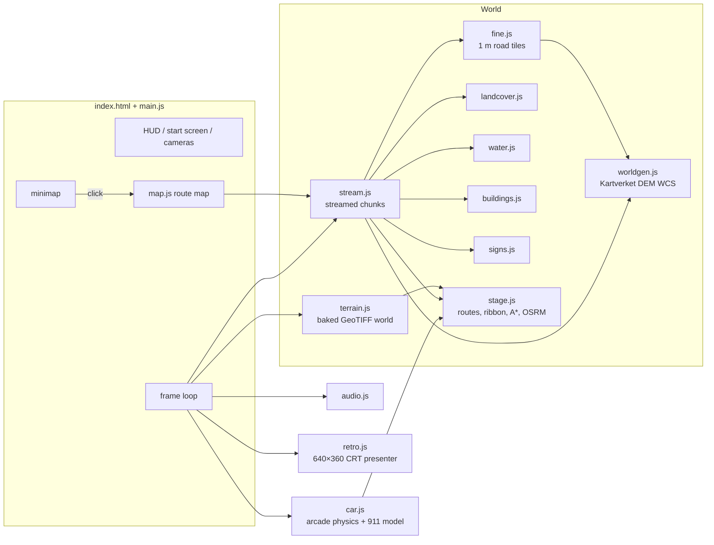

| Module | Responsibility |
|---|---|
| `main.js` | Renderer, lights, game phases (`loading → intro → countdown → racing → finished`), input, three cameras (`1` overhead, `2` chase, `3` driver's seat), HUD, minimap (click → route map), off-road A* from map picks, debug handle `window.__rally`. |
| `car.js` | Raycast-style arcade car: drivetrain, slip tyres, single-DOF suspension with bounded travel, per-wheel ground following, ballistic take-off and wheel-first landing under real gravity, 50 km/h off the road, anti-tunnelling; water (splash, spray, drag, recovery); the lofted Porsche 911 body. |
| `turns.js` | Pace notes from the stage line: bends (direction, angle, severity) and the next one ahead with its distance in 50 m steps for the HUD. |
| `stage.js` | `StageRoute` (4–5 m samples with `nearest()` to the closest segment), A* rally router, OSRM fetch and segmentation, the gravel ribbon, posts and gates. Exports the ribbon lift constants the car rides on. |
| `terrain.js` | The baked demo world (GeoTIFF → height field), `carveRoad` / `flattenPad`, terrain colouring, sea, vegetation, minimap. |
| `stream.js` | Infinite world: 2048 m chunks of 192² samples fetched from Kartverket's WCS, per-chunk carve, LOD meshes with skirts (holes under fine tiles), forest scatter, map features, disposal. |
| `fine.js` | 1 m ground along the roads: 171 m DTM tiles inside ±100 m of the roads near the car, carved with the road profile, meshed at 1 m / 2 m with skirts; `sample()` answers from them first. |
| `landcover.js` | Per-chunk 16 m grid of cover / species / density from OSM polygons and NIBIO SR16 tiles; ground tint. |
| `water.js` | River and stream ribbons draped in the valley floor; flat lake polygons; remembers the bodies and answers `waterAt(x, z)` (depth + surface) for the sea, shore, lakes and rivers, which the car uses for splash, spray, drag and the foam wake. |
| `buildings.js` | One Overpass request per chunk (`out geom`); footprint → oriented rectangle → typed house instances. |
| `signs.js` | NVDB (Statens vegvesen) sign plates and speed limits → textured plates on posts along the route. |
| `bridges.js` | Bridge spans: OSM `bridge=*` (not `no`/`culvert`) or an untagged water crossing ≥ 6 m with water on both sides and the DTM at water level (`waterProbe`, `wetCore`, `markBridgeSpans`); the grade runs bank to bank (`bridgeRaw`), the deck gets an arch and a clearance lift with ramps (`applyBridgeProfile`); one merged mesh per chunk for deck slab, guard rails and piers, plus height-banded rail/pier boxes for the car. The OSRM stage road is matched to the chunk's bridge ways and water when its Overpass answer arrives (`stream.js markRouteBridges`), then re-graded and the chunks around re-carved. |
| `roads.js` | OSM `highway=*` per chunk: spline, grade, settle junctions by rank (`settleJunctions`), carve into the heights, tarmac/gravel ribbons, `RoadNetwork` (24 m buckets) answering `nearest(x, z, limit, filter)` (with grade, crossfall and rank) for the car, trees, houses and signs. In free drive the network is the car's route. |
| `map.js` | The route map (Leaflet over OSM tiles): pins by click or typed `lat, lon`, each snapped to the nearest road of the profile within 1 km (OSRM `/nearest`, via `stage.js`), route-by select (OSRM profiles or off-road A*), FREE DRIVE. The only route picker; opened from the minimap. |
| `cache.js` | IndexedDB cache (up to 32 GB, 10 % of the browser quota kept free, re-measured every 5 min / 256 MB; LRU) in front of every geodata fetch: DEM, Overpass, NVDB, SR16, OSRM, map tiles. |
| `retro.js` | Low-resolution render target with scanlines and dithering. |

## Data sources

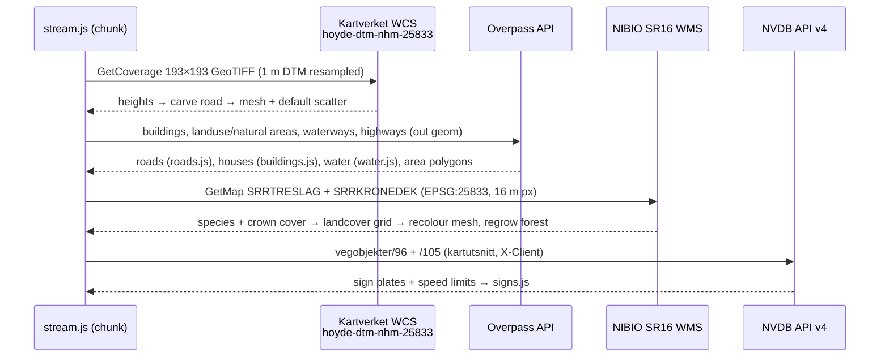

All requests run in the background after the chunk's terrain is visible, so
a slow or failing service only delays its own feature. SR16 and NVDB are
awaited independently of Overpass; a failed Overpass answer sets a 60 s
circuit breaker and the chunk retries every 45 s from `world.update`.

## Free drive

`createStreamingWorld({ center, freeDrive: true })` builds the same world
without a stage route. `world.roads` (a `RoadNetwork`) is handed to
`car.setRoute()`: it implements `nearest()`, `roadWidth`, `startPose()` and
the HUD fields of a `StageRoute`, returns the per-road half width, and snaps
the spawn to the first road that arrives (`world.onSpawnSnapped`).

## Ground truth: one height field

The car, the ribbon, the gates, the trees and the camera all read the same
per-chunk `heights` array through `world.sample(x, z)`:

1. Every road line is a centripetal Catmull-Rom spline through its OSM / OSRM
   nodes (`geo.js splinePolyline`: ≤ 5 m and ≤ 3° per sample) with a graded
   `roadY` (running mean by distance) and a crossfall `bank` (rise per metre
   to the left, non-zero only at junctions). Across the carriageway and
   shoulder the surface is the straight line `roadY + bank · offset`.
2. `carveChunk` pulls every ground cell within the road's half width to that
   line, interpolated along the nearest **segment** (not sample), with a
   smoothstep blend out to the hillside; cells up to 1.4 grid steps beyond the
   band are held at or under the road plane so no triangle rises through it.
   The ribbon mesh is that line itself lifted by `ROAD_RIBBON_LIFT + ROAD_CROWN`
   (not draped on the terrain).
3. `car.groundAt(x, z)` evaluates the same line (plus the ribbon lift blended
   over the shoulder), so the tyres stand on the visible gravel.
4. Bridges are the exception: segments whose two samples are both bridge
   samples are not carved (nor is the terrace drawn), so the ground and the
   river stay natural under the span; the ribbon lies on `roadY` and the car's
   `groundAt` returns the deck for a car up on it (within the rails, no more
   than `DECK_CATCH` below the deck) and the natural ground otherwise; a deck
   the car is on wins over a road passing under it.

### Junctions

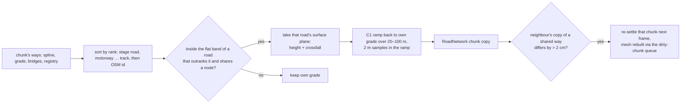

`roads.js settleJunctions` does the settling; the per-way height registry
(`world.roadHeights`) holds the graded profile *before* junctions, so every
copy of a way starts from the same heights and the junction step is computed
from whatever roads are loaded. `streamStats()` reports `roadSettles` and the
slowest chunk road refresh (`roadMsMax`).

## Car physics loop

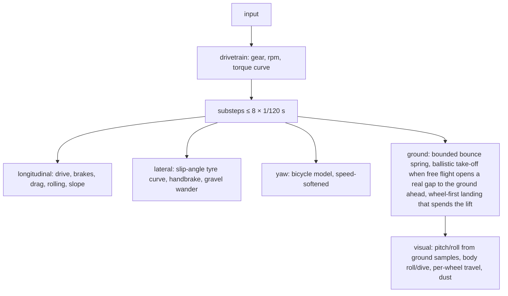

## Build and deploy

Vite with a relative `base`; `npm test` runs Node tests under
`legacy-js/tests/` (browser globals stubbed); GitHub Actions runs the tests,
builds and deploys `legacy-js/dist/` to Pages on every push to `main`.


## Unity / WebAssembly rewrite (`unity/`) — "Grand Tour Norway"

The Unity game is called **Grand Tour Norway** (renamed 2026-11-20; player-visible names only: `productName`, titles,
loader. Namespaces `Rally.*`, folder `_Rally`, storage keys `rally.*` / IndexedDB `rally-cache` and the repo URL stay).
Started 2026-11-16 from `tasks/plan_20261116_unity.md`. Unity 6 (6000.6),
URP, WebGPU first with a WebGL 2 fallback, IL2CPP → wasm. Nothing has been
compiled yet (no Unity on the build machine); `unity/docs/integration-review.md`
lists what to verify in the editor. The JS game in `legacy-js/` stays live
until the Unity build reaches parity.

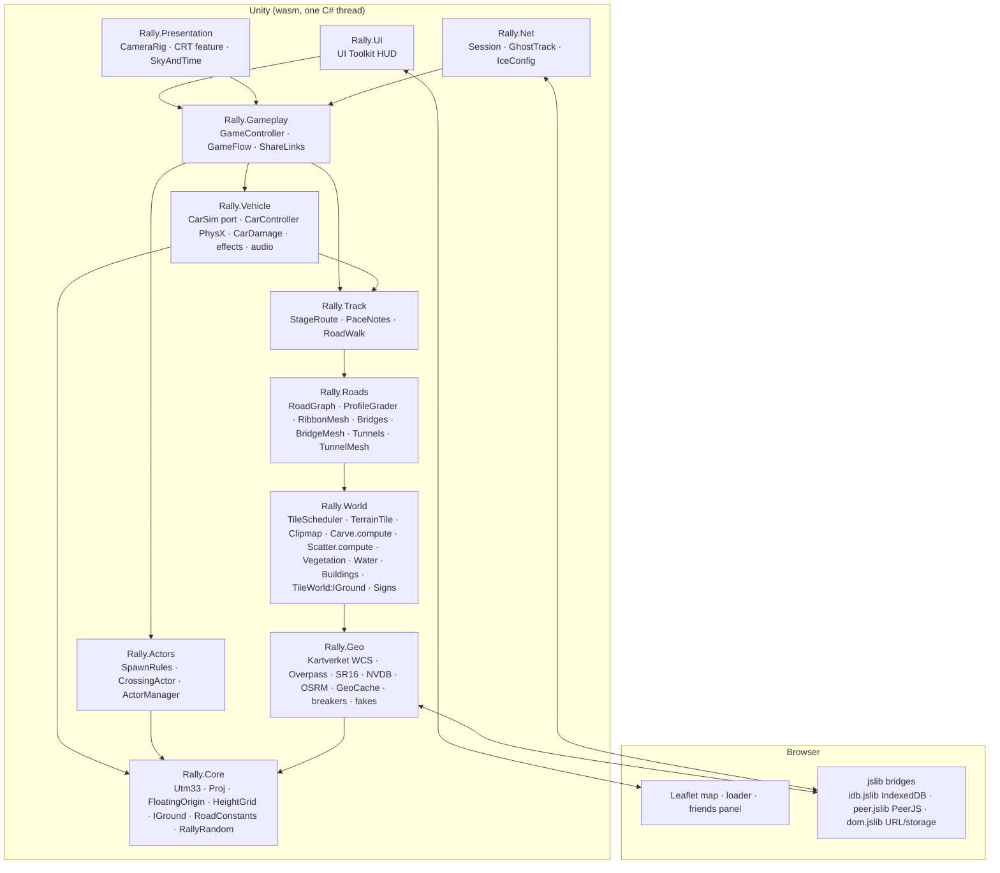

| Layer | What it owns |
|---|---|
| Core | EPSG:25833 frame, floating origin (rebases every 2048 m), the `HeightGrid` ground truth, `IGround`, road profile constants, seeded RNG, log. |
| Geo | Every geodata request with the JS URL formats, the IndexedDB cache **shared with the JS game** (same database), circuit breakers, fakes for tests. |
| World | "Full GPU" ground: heightmaps in a texture array, geometry clipmap with vertex displacement, compute carve (Burst job fallback), landcover splats with tree line and snow line, GPU scatter of species-typed trees drawn with `RenderMeshIndirect`, water (lakes, rivers, sea, wake), extruded OSM buildings, real road signs (NVDB plates placed on the shoulders, Norwegian faces painted into a shared atlas, one mesh per near tile), physics colliders (buildings mesh, pooled tree capsules, sign posts as props, water triggers), procedural sky. |
| Roads | OSM road graph with NVDB attributes, grading, carve segments, ribbon meshes, `Nearest` (all roads, on the ground, or bridge decks). Bridges: spans from `bridge=*` or a water crossing, deck profile (bank to bank, clearance, ramps), one deck/rail/pier mesh per tile with a rail/pier collider; spans carve nothing and the car's ground (`TileWorld`, an `ILayeredGround`) is the deck while the car is up on it. Tunnels: `tunnel=yes` ways are tubes graded straight between their portals (under the sea 40 m down), carve nothing (the mountain stays), drawn as tube + lamps + portals (Rally/Tunnel), solid walls; the car's ground is the floor while it is below the roof, the terrain shader cuts holes at portals; avalanche galleries are roofed roads. Ways that share an OSM node meet at one height (node registry). |
| Track | Stage line (4 m samples, segment-nearest), pace notes (positive = left in Unity's frame), the seeded `RoadWalk` endless-stage generator. |
| Vehicle | Faithful port of `car.js` as a pure `CarSim` + PhysX overlap collisions, water triggers, per-system damage (engine, steering, suspension corners, radiator, body, windscreen, lights) feeding back into the sim, GPU dents, particles, lights, audio. The garage: one `CarSpec` per car (mass, power, gears, driven wheels, grip, travel, turbo lag, body box measured off the model) and `Garage` (wire ids, names, credits, card stats). |
| Actors | Seeded encounters by land cover (moose, deer, sheep, reindeer north of 65°, pedestrians, dogs, cyclists, tractors), crossing state machine, hits and near misses. |
| Gameplay | Phases, clock, penalties, retirement, share links in the JS formats, the bootstrap `GameController`. |
| Net | PeerJS rooms byte-compatible with the JS wire format, ghost cars, ICE config with a TURN slot. |
| UI / Presentation | HUD, start screen hooks, three cameras, CRT presenter, sun by hour/month/latitude. |

Car art: `unity/Assets/_Rally/Art/Cars/<name>/` with a `LICENSE.txt` each
(CC BY 4.0 models only; list in `unity/docs/car-models.md`).

### Unity streaming: tile seams and the frame budget (2026-11-20)

Every tile is its own Kartverket request, so neighbours disagreed on their common edge (coarse 0.75 m on average, up to
33 m at cliffs) and the 1 m tiles stood up to 10 m off the 8 m ground at their outline. Now a new tile takes its loaded
neighbours' edges and corners (`TileWorld.Stitch`), a fine tile blends into the coarse ground over 16 m at a bare outline
and fades in over 0.5 s (`TerrainGround.hlsl FineWeight`; `TileWorld.FineWeight` is the CPU twin the car drives on), the
carve collects what it carves on both sides of an edge, a ribbon stretch is drawn by one tile, and roads over ground not
loaded yet are graded again once it is in. Streaming work runs in pieces within 5 ms per frame (`Core/WorkBudget`; the
web build has one C# thread, so pieces, not jobs):

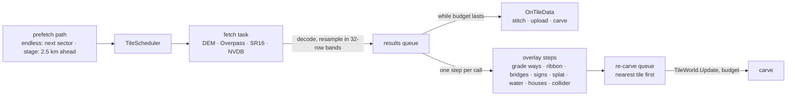

`FrameProbe` (Core) times every frame and attributes slow ones; `PreviewShots -previewGlide -previewDrive` and
`-previewSeams` are the measuring tools.

### Unity bridges (2026-11-20)

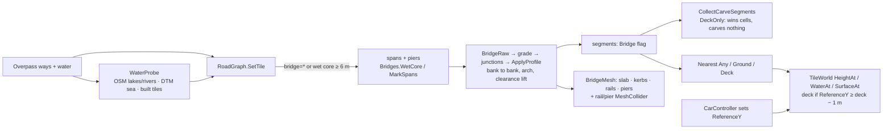

### Unity tunnels and ways meeting at a node (2026-11-20)

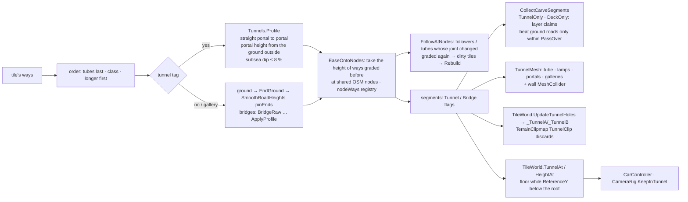

### Unity route map: place search (2026-11-20)

The START / FINISH boxes live in the web template (`unity/Assets/WebGLTemplates/Rally/index.html`, `window.rallyMap`);
C# is unchanged: a chosen place is sent as the same `pick` event as a map click.

```mermaid
sequenceDiagram
  participant U as Player
  participant T as index.html (rallyMap)
  participant K as Kartverket stedsnavn API
  participant C as GameController.OnMapEvent
  U->>T: types "Hovden" (300 ms debounce, stale fetch aborted)
  T->>K: /navn?sok=Hovden*&treffPerSide=500 (fuzzy=true only if nothing found)
  K-->>T: names (type, municipality, point)
  T->>T: rank: By/Tettsted → small settlements → kommune → rest; dedupe; Norway only; 12 rows
  U->>T: ↑↓ Enter or click "Hovden — tettsted, Bykle"
  T->>T: pin + pan/zoom (fit both pins)
  T->>C: SendMessage('Map','OnMapEvent',{ev:'pick',which,lat,lon})
  C->>T: OSRM /nearest → MapSetPin (snapped) + MapStatus
```

Keys typed in a box are stopped in a window capture listener registered before Unity loads, so G / M / R / N / H / Esc
do not reach the game; Esc closes the list, then the map.

### Unity car chooser (2026-11-20)

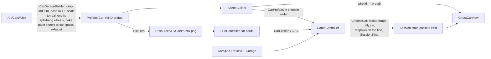

Each prefab's `CarController.Kind` picks its `CarSpec`; the wheel pivots sit at the spec's axles, so the builder logs the
geometry it measures and warns when CarSpec drifts from the model. A car whose model is not in Art/Cars yet (the buggy)
is left out of the scene list and so out of the chooser. A car is "on the road" while a wheel is on the stage
line's ribbon or on any road the world draws (`IGround.SurfaceAt` at the centre and the wheels); top speed on asphalt comes
from `CarSpec.Aero`, gravel roads stop at `CarSim.GravelMaxSpeed` (120 km/h), the off-road limit is `CarSpec.OffroadMax`.

### Unity solids: the car stays outside objects (2026-11-20)

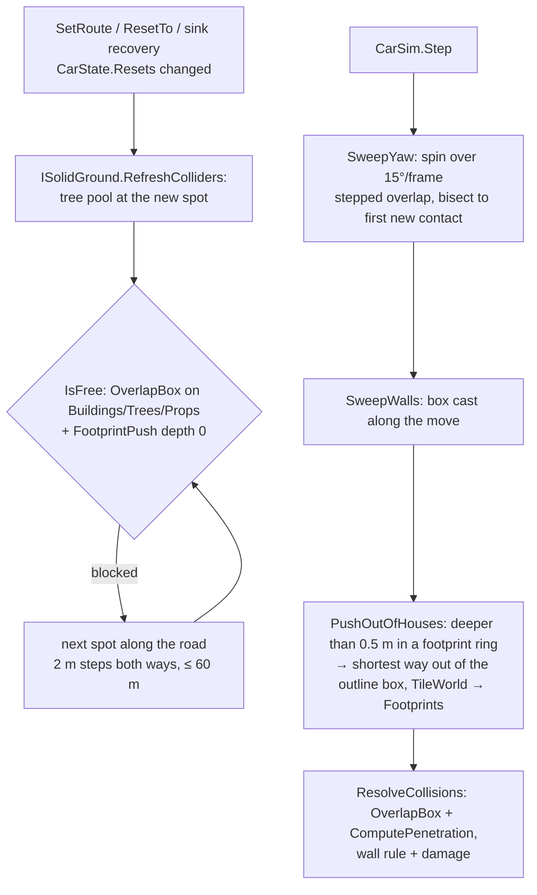

Houses are `BuildingSet` per coarse tile: a combined wall/roof mesh with a MeshCollider (layer Buildings), an outline box
(`FootprintBox`) and the footprint ring per house. PhysX alone cannot tell a car wholly inside a house (no triangle touched)
and pushes a car past half way through a wall along the nearest triangle; the ring test catches both, so a house that
streams in on top of the car, a replaced overlay or a fast hit always ends with the car outside.

### Unity start screen, LOG bar and MENU (2026-11-20)

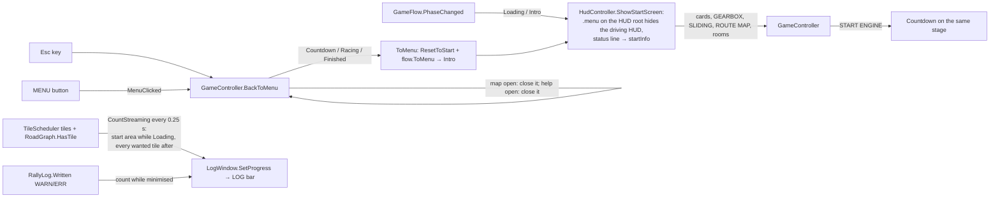

The start screen is one column inside a ScrollView (min-height = viewport, so it centres when it fits and scrolls when
it does not). The panel scales with width and height alike (`RallyPanel.match` 0.5); `.narrow` (panel narrower than 900
units, phones in portrait) moves the HUD buttons under the clock and wraps the car cards 4 + 4. The log window starts
minimised; F2 or a click on the LOG bar opens it.

