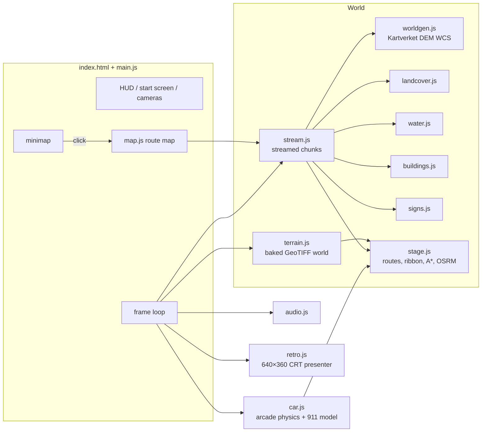
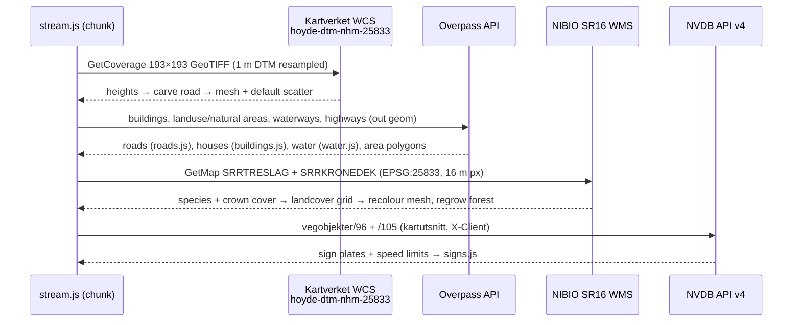
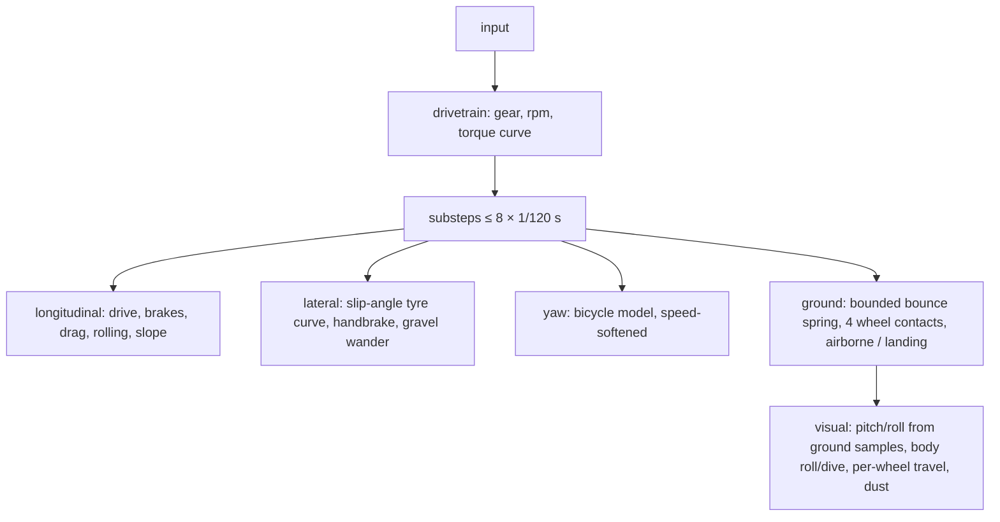

# Architecture

_Updated 2026-11-14._

Retro Norway Rally is a static, browser-only Three.js game. There is no
backend: terrain, map features and road signs are fetched straight from
public Norwegian geodata services and OpenStreetMap, then turned into
low-poly geometry on the fly.

## Modules

| Module | Responsibility |
|---|---|
| `main.js` | Renderer, lights, game phases (`loading → intro → countdown → racing → finished`), input, three cameras (`1` overhead, `2` chase, `3` driver's seat), HUD, minimap (click → route map), off-road A* from map picks, debug handle `window.__rally`. |
| `car.js` | Raycast-style arcade car: drivetrain, slip tyres, single-DOF suspension with bounded travel, per-wheel ground following, anti-tunnelling; water (splash, spray, drag, recovery); the lofted Porsche 911 body. |
| `stage.js` | `StageRoute` (4–5 m samples with `nearest()` to the closest segment), A* rally router, OSRM fetch and segmentation, the gravel ribbon, posts and gates. Exports the ribbon lift constants the car rides on. |
| `terrain.js` | The baked demo world (GeoTIFF → height field), `carveRoad` / `flattenPad`, terrain colouring, sea, vegetation, minimap. |
| `stream.js` | Infinite world: 2048 m chunks of 192² samples fetched from Kartverket's WCS, per-chunk carve, LOD meshes with skirts, forest scatter, map features, disposal. |
| `landcover.js` | Per-chunk 16 m grid of cover / species / density from OSM polygons and NIBIO SR16 tiles; ground tint. |
| `water.js` | River and stream ribbons draped in the valley floor; flat lake polygons; remembers the bodies and answers `waterAt(x, z)` (depth + surface) for the sea, shore, lakes and rivers, which the car uses for splash, spray, drag and the foam wake. |
| `buildings.js` | One Overpass request per chunk (`out geom`); footprint → oriented rectangle → typed house instances. |
| `signs.js` | NVDB (Statens vegvesen) sign plates and speed limits → textured plates on posts along the route. |
| `roads.js` | OSM `highway=*` per chunk: carve into the heights, tarmac/gravel ribbons, `RoadNetwork` (48 m buckets) answering `nearest(x, z)` for the car, trees, houses and signs. In free drive the network is the car's route. |
| `map.js` | The route map (Leaflet over OSM tiles): pins by click or typed `lat, lon`, route-by select (OSRM profiles or off-road A*), FREE DRIVE. The only route picker; opened from the minimap. |
| `retro.js` | Low-resolution render target with scanlines and dithering. |

## Data sources

All requests run in the background after the chunk's terrain is visible, so
a slow or failing service only delays its own feature. SR16 and NVDB are
awaited independently of Overpass; a failed Overpass answer sets a 60 s
circuit breaker and the chunk retries every 45 s from `world.update`.

## Free drive

`createStreamingWorld({ center, freeDrive: true })` builds the same world
without a stage route. `world.roads` (a `RoadNetwork`) is handed to
`car.setRoute()`: it implements `nearest()`, `roadWidth`, `startPose()` and
the HUD fields of a `StageRoute`, returns the per-road half width, and snaps
the spawn to the first road that arrives (`world.onSpawnSnapped`).

## Ground truth: one height field

The car, the ribbon, the gates, the trees and the camera all read the same
per-chunk `heights` array through `world.sample(x, z)`:

1. The route gets a smoothed `roadY` profile from a coarse corridor DEM.
2. `carveChunk` pulls every ground cell within the road's half width to the
   height interpolated along the nearest **route segment** (not sample), with
   a smoothstep blend out to the hillside. The ribbon mesh is the same ruled
   surface lifted by `ROAD_RIBBON_LIFT + ROAD_CROWN`.
3. `car.groundAt(x, z)` = `sample(x, z)` + the ribbon lift blended over the
   shoulder, so the tyres stand on the visible gravel.

## Car physics loop

## Build and deploy

Vite with `base: '/norwayralley/'`; `npm test` runs Node tests under
`tests/` (browser globals stubbed); GitHub Actions builds and deploys `dist/`
to Pages on every push to `main`.
