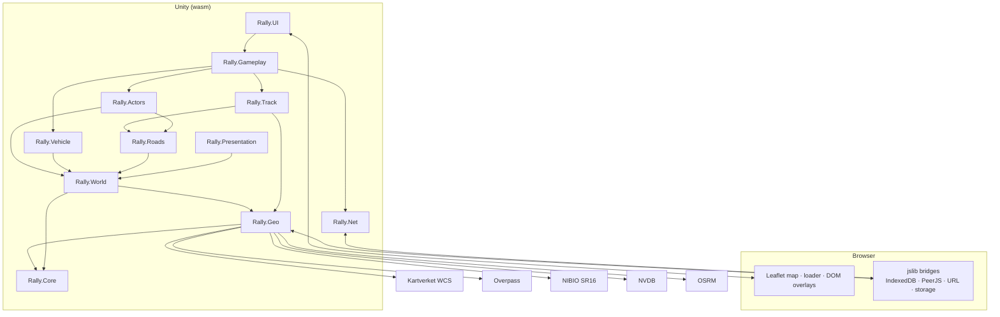

# Rewrite: Unity → WebAssembly — plan (2026-11-16)

User request: "Make a plan for rewriting the app to Unity & WebAssembly for
speed and better graphics. Take the ideas from the current app and make a
well structured codebase, ready for infinite track generation based on the
current Norway DTM, map overlays generated buildings, trees etc. making it
a few notches more realistic. Also make it ready for e.g. animals and
pedestrians crossing roads for extra challenges."

Status: **plan only, nothing built.** The Three.js game stays live and
keeps getting fixes until the Unity build reaches parity (phase 2 below).

---

## 1. What we keep, what we gain, what we pay

### Ideas carried over from the current app (13 k lines of JS)
- One height field is ground truth for car, road, trees, camera
  (`world.sample`). Roads are *carved* into the DTM, not draped on it.
- Streamed world: 2048 m coarse chunks + 1 m corridor tiles near the road,
  every feature fetched in the background after the ground is visible, each
  service failing on its own (circuit breakers, retries).
- Live Norwegian geodata, no backend: Kartverket DTM (WCS), NIBIO SR16
  (species, crown cover), OSM Overpass (roads, buildings, land use, water),
  NVDB (signs, speed limits, surface, width), OSRM (routing, snapping).
- Browser-side cache, 10 GB LRU, so a stage is fast the second time.
- Arcade raycast car tuned over many sessions: slip tyres, single-DOF
  suspension, ballistic take-off only when a real gap opens, wheel-first
  landing, water drag, 50 km/h off road. **Port the model, do not re-tune
  it on PhysX wheel colliders.**
- Route map with 1 km snapping, OSRM profiles, off-road A*, share links
  (`?route=`, `?drive=`), saved routes, 4-letter PeerJS rooms, pace notes,
  the CRT presenter, the start-screen credits and attributions.

### What Unity + WebAssembly buys
- Rendering: URP with cascaded shadows, SSAO, bloom, volumetric fog, physical
  sky, PBR materials, LOD groups, GPU-instanced trees and grass, terrain
  splat maps, water with reflections. This is the "few notches more
  realistic"; most of it is configuration, not code.
- CPU: C# → IL2CPP → wasm, Burst-compiled jobs with wasm SIMD. Mesh carving,
  landcover rasterising, A* and physics substeps run 5–20× faster than the
  current JS, which matters for 1 m corridor tiles and for the NPC layer.
- Tooling: profiler, frame debugger, scene view, play-mode tests on the real
  mesh (lesson from `tasks/lessons.md`, 2026-11-15).

### What it costs (state this to the user up front)
- **Download**: a URP web build is 15–40 MB compressed vs ~1 MB today. First
  load 5–20 s on a good link. Mobile hotspot players feel it.
- **Memory**: wasm heap 1–2 GB; iOS Safari kills tabs above ~1.5 GB.
  The 10 GB IndexedDB cache stays outside the heap (JS bridge).
- **Single-threaded**: Unity's web platform runs all C# on one thread
  (no managed threads, no multithreaded GC). Jobs still run through the
  job system but execute on the main thread; Burst still gives SIMD speed.
  Native C/C++ threads are experimental only. Design everything as
  time-sliced work, as today.
- **Graphics API**: WebGL 2 is the default. WebGPU is a supported backend
  from Unity 6.1 and reportedly production-ready from 6000.6 (Sept 2026);
  it adds compute shaders but only in secure contexts, and falls back to
  WebGL 2 silently. Ship WebGL 2 first, enable WebGPU as an opt-in.
- **Hosting**: GitHub Pages cannot set `Content-Encoding`, so a Brotli
  build either ships with Unity's *Decompression Fallback* (bigger loader,
  no wasm streaming) or uncompressed. Pages serves gzip for text, not for
  `.wasm`. Plan: Brotli + fallback, measure, consider Cloudflare Pages
  (free, sets headers, also solves the TURN worker) if load time hurts.
- **Licence**: Unity Personal is free under USD 200 k revenue and needs an
  activation step in CI (`game-ci/unity-builder` with a licence secret).
- **Iteration speed** drops: a web build takes minutes, not seconds. Test
  in the editor; the web build is a nightly check.

Alternatives considered: Godot 4 web (weaker renderer, worse wasm perf),
Unreal (no web target), Bevy/Rust (everything hand-built). Unity is the
right call if the realism and NPC goals are real; if the goal were only
"faster", Three.js + WebGPU + workers would be a smaller step.

---

## 2. Target stack

| Piece | Choice | Why |
|---|---|---|
| Engine | Unity 6 (6000.6 or newer LTS when available) | WebGPU backend, wasm 2023 feature set, 4 GB heap |
| Render | URP, Forward+ | Only pipeline with full web support; lights, fog, post-processing |
| Scripting | C# 9, IL2CPP, Burst + Jobs, `Unity.Mathematics`, `Unity.Collections` | SIMD wasm, allocation-free hot paths |
| Ground | Unity Terrain tiles (coarse 2048 m, fine 256 m corridor) + holes | Splat maps, tree/detail instancing, LOD for free; carving via `SetHeightsDelayLOD` |
| Roads/water/buildings | Generated meshes (`Mesh.MeshData` API) | Same approach as today, 10× faster |
| UI | UI Toolkit (HUD, menus), Leaflet map kept in the DOM over the canvas via jslib | Leaflet already does the map well; no need to re-implement OSM tiles |
| Audio | Unity audio + procedural engine note (port `audio.js`) | |
| Web bridge | `.jslib` plugins: IndexedDB cache, PeerJS, URL params, localStorage, clipboard | Unity web has no IndexedDB API beyond IDBFS; PeerJS/WebRTC not available in Unity web natively |
| Tests | Unity Test Framework: EditMode (pure logic) + PlayMode (car on real DTM) | Freeze behaviour as today's `tests/` does |
| CI/CD | GitHub Actions: `game-ci/unity-test-runner` + `unity-builder` → Pages | Same push-to-deploy flow |
| Assets | Addressables, remote catalog on the same host | Car, trees, houses, signs, sounds load after the game shell |

---

## 3. Codebase structure

One Unity project `unity/` beside the current `src/` (the JS game is
deleted only after parity). Assembly definitions per layer; lower layers
never reference higher ones. Pure logic lives in plain C# classes with no
`MonoBehaviour`, so EditMode tests run without a scene.

```
unity/
  Assets/_Rally/
    Runtime/
      Core/          Rally.Core        – coordinates (EPSG:25833 ↔ world, floating origin),
                                         clock, event bus, logging, seeded RNG, config SOs
      Geo/           Rally.Geo         – source interfaces + clients: Kartverket WCS,
                                         Overpass, SR16 WMS, NVDB v4, OSRM, geoBoundaries;
                                         IndexedDB cache bridge; circuit breakers; parsers
                                         (GeoTIFF, Overpass JSON, NVDB JSON)
      World/         Rally.World       – tile scheduler, TerrainTile (coarse/fine), carve jobs,
                                         landcover raster → splat, vegetation scatter,
                                         water bodies, buildings, signs, props, disposal
      Roads/         Rally.Roads       – road graph (OSM ways + NVDB attributes), geometry,
                                         profile grading, carve masks, ribbons, markings,
                                         RoadNetwork.Nearest()
      Track/         Rally.Track       – Stage (route samples, Nearest, gates), routers
                                         (OSRM, off-road A*), InfiniteStageGenerator,
                                         pace notes, sectors, seeds
      Vehicle/       Rally.Vehicle     – the arcade car model (port of car.js), input,
                                         ground query, water interaction, visuals, audio
      Actors/        Rally.Actors      – NPC framework: spawn rules, behaviours, hazards
                                         (animals, pedestrians, later traffic)
      Gameplay/      Rally.Gameplay    – phases, timing, penalties, damage, saved routes,
                                         share links, settings
      Net/           Rally.Net         – PeerJS bridge, room codes, ghost cars, ICE config
      UI/            Rally.UI          – HUD, start screen, friends panel, debug window,
                                         map bridge (Leaflet in DOM)
      Presentation/  Rally.Presentation– URP assets, sky/time-of-day, weather, CRT render
                                         feature, camera rigs (1 overhead, 2 chase, 3 seat)
    Editor/          Rally.Editor      – tile inspector, stage preview, bake tools
    Plugins/WebGL/   *.jslib           – idb.jslib, peer.jslib, dom.jslib
    Tests/EditMode   Rally.Tests.Edit  – pure logic (turns, snapping, carve, graph walk, spawn rules)
    Tests/PlayMode   Rally.Tests.Play  – car on synthetic + real DTM, tile streaming, NPC crossings
  Packages/manifest.json
  ProjectSettings/
docs/            keeps README/ARCHITECTURE/CHANGES; ARCHITECTURE gets the diagram below
.github/workflows/unity.yml
```



### Key interfaces (Rally.Geo)
```csharp
interface IDemSource      { Task<HeightGrid> Fetch(Bounds25833 b, float cellM, CancellationToken ct); }
interface IRoadSource     { Task<RoadGraph>  Fetch(Bounds25833 b, CancellationToken ct); }
interface ILandcoverSource{ Task<CoverRaster> Fetch(Bounds25833 b, float cellM, CancellationToken ct); }
interface IFeatureSource  { Task<Features>   Fetch(Bounds25833 b, FeatureKinds k, CancellationToken ct); } // buildings, water, landuse, power lines
interface ISignSource     { Task<SignSet>    Fetch(Bounds25833 b, CancellationToken ct); }
interface IRouter         { Task<RouteResult> Route(LatLon a, LatLon b, Profile p, CancellationToken ct);
                            Task<Snap?>       Nearest(LatLon p, Profile prof, float radiusM, CancellationToken ct); }
interface IGeoCache       { Task<byte[]?> Get(string key); Task Put(string key, byte[] v, string kind); } // jslib → IndexedDB
```
Every client is wrapped by `CachedSource<T>` (key = canonical URL) and
`CircuitBreaker` (60 s open, 45 s retry), the same policy as today. A
`FakeSources` set (flat ground, one road, one house) backs tests and the
editor without network.

### World model (Rally.World)
- Coordinates: EPSG:25833 metres. The Unity origin is re-based every
  2048 m of travel (`FloatingOrigin`), so float precision never degrades.
  Every stored position is a `double2` in 25833; the scene holds offsets.
- `TileScheduler`: ring of coarse tiles (2048 m, 257-sample heightmap =
  8 m cells) within 4.4 km of a velocity-led point; fine tiles (256 m,
  1 m cells) within ±100 m of the roads near the car; a coarse tile gets a
  terrain hole under each fine tile. Budget: one carve job and one
  `SetHeightsDelayLOD` per frame; everything else via `await` chains.
- `CarveJob` (Burst): same rule as today — pull cells within the road half
  width to the graded profile height, smoothstep blend to the hillside.
- `Landcover`: SR16 species/crown + OSM polygons → 16 m raster → terrain
  splat weights (forest floor, bog, pasture, rock, snow) + tree prototypes
  per species (spruce, pine, birch, mountain birch) with density from crown
  cover; above the local tree line (from DTM + latitude) no trees, rock
  and snow splats. Unity terrain trees give instancing + billboards.
- `Water`: lakes as flat planar meshes with a reflective shader; rivers as
  ribbons; sea plane; `WaterAt()` keeps the car's splash/drag behaviour.
- `Buildings`: OSM footprint → polygon extrusion (real outline, not just
  rectangles) with `building:levels` / `height` / `roof:shape`; Norwegian
  palette and gabled roofs by default; barns/boathouses/cabins by tag;
  LOD groups; a detail pass adds doors/windows from a trim sheet.
- `Props`: NVDB signs on posts (ported), guard rails where NVDB says so,
  power lines from OSM `power=line`, fences at pasture edges, bus stops.
- Realism knobs in one `WorldStyleSO` asset so "retro" vs "realistic" is a
  preset, not a branch.

### Vehicle (Rally.Vehicle)
Line-by-line port of `car.js` into a Burst-friendly `CarState` struct +
`CarSim.Step(ref state, in Input, in GroundQuery, dt)` with the same
substep (≤ 8 × 1/120 s), the same tyre curves, take-off checkpoints and
landing rule. The `MonoBehaviour` only feeds input and applies the pose.
PlayMode tests replay today's `tests/jump.test.mjs` scenarios (table-top
at 60/120 km/h, crest at 100 km/h: exactly one take-off) on the real demo
DTM.

---

## 4. Infinite track generation (Rally.Track)

Goal: drive forever on a stage that never repeats and is reproducible
from a seed. Two generators behind one `IStageGenerator`:

1. **Road walk** (default): a graph walk over OSM roads with NVDB
   attributes. From the current segment, score each outgoing edge:
   curvature density, elevation change, gravel/unpaved surface, low
   road class, forest cover, not yet driven, no tunnels/ferries/motorways,
   mild preference for continuing direction. Pick by weighted random from
   the seed. Build 2 sectors (~5 km each) ahead of the car, request the
   tiles they need, and recycle sectors behind. Every 3 sectors a service
   park (time-check, damage repair).
2. **Carved stage** (where the road graph is thin, e.g. fjell): extend the
   existing off-road A* from `stage.js` into a direction-biased corridor
   search over the DTM with grade and curvature limits, carved like today.
   The generator may splice a carved link to join two road clusters.

Shared: `Stage` = 4 m samples with `Nearest()`, pace notes from
`turns.js` (ported, same sign convention), gates, sector times.
`StageSeed { ulong seed; LatLon start; GeneratorKind kind; }` is what a
share link carries; two players with the same seed get the same stage,
which is what multiplayer needs.

---

## 5. Actors: animals, pedestrians, traffic (Rally.Actors)

- `SpawnRules` evaluate the landcover and features under each upcoming
  road segment: moose and deer in forest, sheep near pasture and open
  fjell, reindeer north of ~65° N on open ground, pedestrians and dogs
  where building density is high, cyclists on paved roads, tractors at
  farm tracks. Spawn 150–400 m ahead, out of sight, with a per-sector
  budget set by difficulty.
- `Actor` = pure C# state machine (Idle → Alert → Cross → Flee/Stop)
  driven by a `Crossing` spline across the road; animation via Animator
  with a tiny set of clips. No NavMesh: they only need to cross or stand.
- Telegraphing: rustle/bell/bark audio, a brief sign-style icon in the
  pace notes ("CAUTION"), animal warning signs from NVDB where they exist.
- Consequences: hit = time penalty + damage (steering pull, cracked
  windscreen), near miss = bonus; sheep stop traffic until you slow down.
- Deterministic from the stage seed and sector index so friends in the
  same room meet the same moose at the same place.
- Later: oncoming traffic on public-road stages using the same framework.

---

## 6. Multiplayer, sharing, saving (Rally.Net / Gameplay)

- Keep PeerJS: `peer.jslib` wraps `new Peer(prefix + code, { config })`
  and the data channel; Unity sends 10 Hz pose + callsign, same wire
  format as today so JS and Unity clients could even share a room during
  the transition.
- `config.iceServers` becomes explicit (STUN + a TURN on TCP 443) — the
  open TURN question (Cloudflare worker vs Metered static) applies here
  unchanged.
- Share links: `?route=` and `?drive=` stay; `?seed=` added for infinite
  stages. Saved routes in localStorage via `dom.jslib`.
- Rooms stay 4-letter codes; the friends panel keeps the Bluetooth note.

---

## 7. Milestones

Each phase ends with a deployed build, updated docs, and tests green.

### Phase 0 — Spike (1–2 weeks) · go/no-go
- [ ] Unity 6 project, URP, web build on GitHub Pages behind `/unity/`.
- [ ] `KartverketDem` + `IndexedDB` bridge → one coarse Terrain tile with
      SR16 splat and instanced trees.
- [ ] `CarSim` port driving on it with the chase camera.
- [ ] Measure: build size, load time (desktop, Android Chrome, iOS Safari),
      frame time at 1080p, heap after 20 tiles.
- [ ] Decide: continue, or stay on Three.js and add WebGPU/workers.

### Phase 1 — World parity (3–4 weeks)
- [ ] Tile scheduler, floating origin, fine corridor tiles with holes.
- [ ] Roads: graph, grading, carve, ribbons, `Nearest`.
- [ ] Landcover, water, buildings (extruded footprints), signs.
- [ ] Circuit breakers, retries, cache budget, service status in a debug
      window; `FakeSources` for tests.

### Phase 2 — Game parity (3 weeks) → switch the live site
- [ ] Phases, countdown, timing, HUD (UI Toolkit), three cameras, retro
      CRT render feature, audio.
- [ ] Route map (Leaflet bridge), OSRM routing + 1 km snapping, off-road
      A*, free drive, share links, saved routes.
- [ ] Pace notes, real jumps, water, off-road speed cap (ported tests).
- [ ] PeerJS rooms, ghost cars, ICE config.
- [ ] CI: EditMode + PlayMode tests, build, deploy. README/ARCHITECTURE/
      CHANGES rewritten; JS sources archived in a `legacy/` tag.

### Phase 3 — Realism (3 weeks)
- [ ] Physical sky + time of day, fog, weather (rain, snow, wet road).
- [ ] PBR materials, trim sheets for houses, species tree models, grass
      detail, rock/snow above tree line, road markings and surface from
      NVDB, guard rails, power lines, fences.
- [ ] Car: new 911 model with interior for camera 3, damage decals.
- [ ] Quality presets (mobile / desktop / WebGPU).

### Phase 4 — Infinite stages (2–3 weeks)
- [ ] Road-walk generator, sectors, service park, `?seed=`.
- [ ] Carved-link generator for thin road graphs.
- [ ] Endless mode on the start screen; sector leaderboard in a room.

### Phase 5 — Actors (2–3 weeks)
- [ ] Spawn rules from landcover/features, actor FSM, crossings.
- [ ] Moose, sheep, reindeer, pedestrian, cyclist; audio telegraphing;
      penalties and damage.
- [ ] Deterministic spawns in rooms.

### Phase 6 — Polish and mobile (ongoing)
- [ ] Touch controls, gamepad, load-time work (Addressables, texture
      compression per platform), memory ceiling on iOS.

Rough total: 4–5 months of focused work for one person; the first
drivable Unity build appears in phase 0.

---

## 8. Port map

| Today (`src/`) | Unity |
|---|---|
| `main.js` | `Rally.Gameplay.GameFlow`, `Rally.UI.*`, `Rally.Presentation.CameraRig` |
| `car.js` | `Rally.Vehicle.CarSim` (struct + Burst), `CarView`, `CarAudio` |
| `turns.js` | `Rally.Track.PaceNotes` (EditMode test ported 1:1) |
| `stage.js` | `Rally.Track.Stage`, `OsrmRouter`, `OffroadRouter`, `Rally.Roads.Ribbon` |
| `stream.js`, `lod.js`, `fine.js` | `Rally.World.TileScheduler`, `CoarseTile`, `FineTile` |
| `worldgen.js`, `corridor.js` | `Rally.Geo.KartverketDem`, `Rally.Roads.ProfileGrader` |
| `terrain.js` (demo world) | a baked `DemoTile` asset for tests and the first screen |
| `landcover.js` | `Rally.World.Landcover` + `Rally.Geo.Sr16Source` |
| `water.js` | `Rally.World.Water` |
| `buildings.js` | `Rally.World.Buildings` (polygon extrusion) |
| `signs.js` | `Rally.World.Signs` + `Rally.Geo.NvdbSource` |
| `roads.js` | `Rally.Roads.*` |
| `map.js` | Leaflet kept in DOM, `Rally.UI.MapBridge` + `dom.jslib` |
| `cache.js` | `idb.jslib` + `Rally.Geo.GeoCache` |
| `multiplayer.js` | `peer.jslib` + `Rally.Net.Room` |
| `retro.js` | URP `CrtRenderFeature` |
| `audio.js` | `Rally.Vehicle.CarAudio` |
| `saved.js`, `share.js` | `Rally.Gameplay.SavedRoutes`, `ShareLinks` |
| `tests/*.test.mjs` | `Tests/EditMode/*` and `Tests/PlayMode/*` |

---

## 9. Risks and open decisions

| Risk | Mitigation |
|---|---|
| Load size scares off hotspot players | Addressables, Brotli + fallback, measure in phase 0; keep the JS build reachable until parity |
| iOS Safari memory | Quality preset: 8 m coarse tiles, no fine tiles beyond 50 m, 1 GB heap cap |
| Overpass unreliability (seen 2026-11-13) | Same breakers; phase-4 option: pre-baked road graph tiles on the host |
| Single thread stalls on big carves | Burst jobs sliced per frame, `SetHeightsDelayLOD`, mesh uploads via `MeshData` |
| Re-tuning the car by accident | `CarSim` is a pure port with replayed test scenarios before any change |
| Unity licence in CI | Personal licence activation file stored as a repo secret |

Decisions needed from the user before phase 0:
1. Hosting: stay on GitHub Pages (fallback decompressor) or move to
   Cloudflare Pages (proper headers, and a Worker for TURN credentials)?
2. Target platforms for the first release: desktop browsers only, or
   Android/iOS browsers from day one (changes the quality presets)?
3. Visual direction: keep the retro CRT look as the default with
   "realistic" as a preset, or the other way round?
4. Renderer: WebGL 2 only for the first release, or also WebGPU opt-in?

## Review
_Empty until the spike runs._
